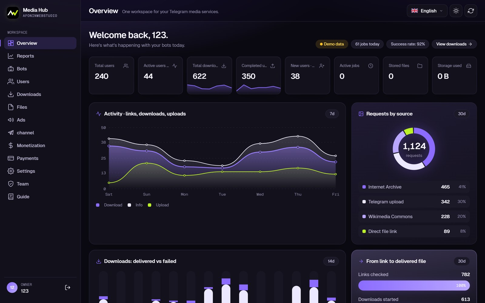
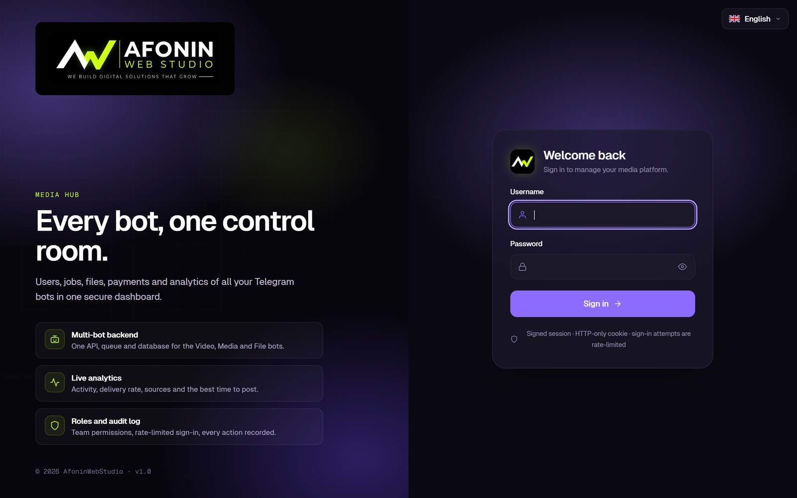
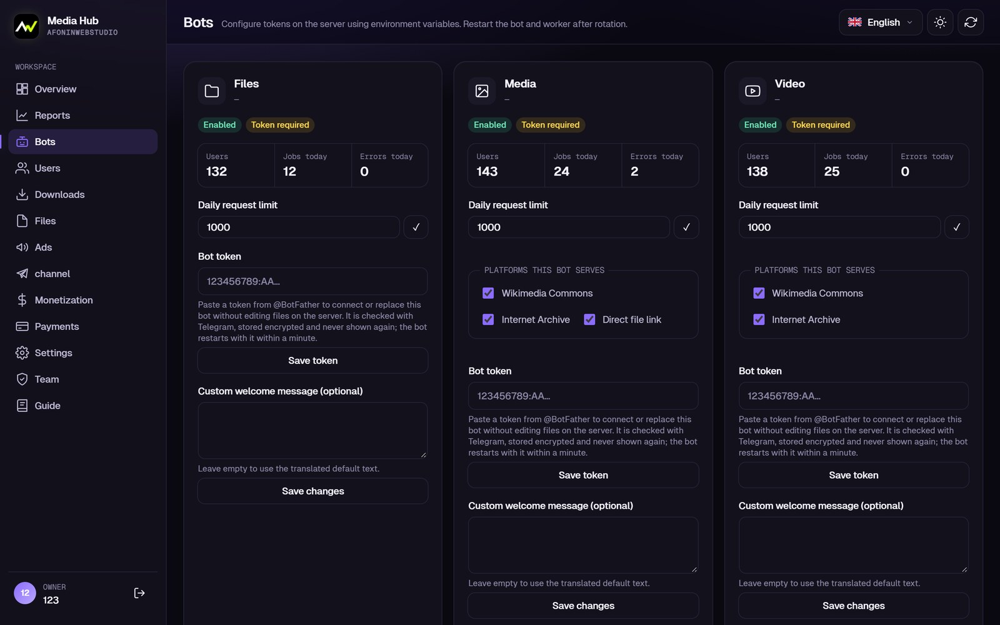
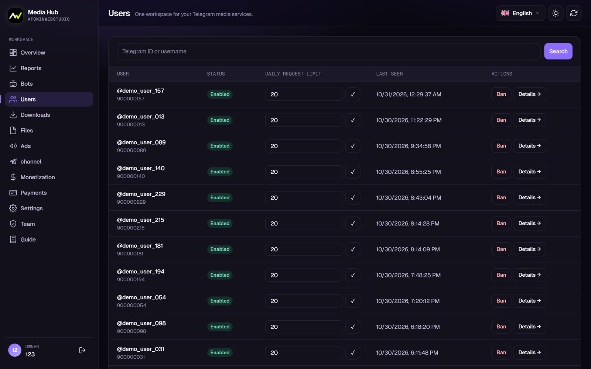
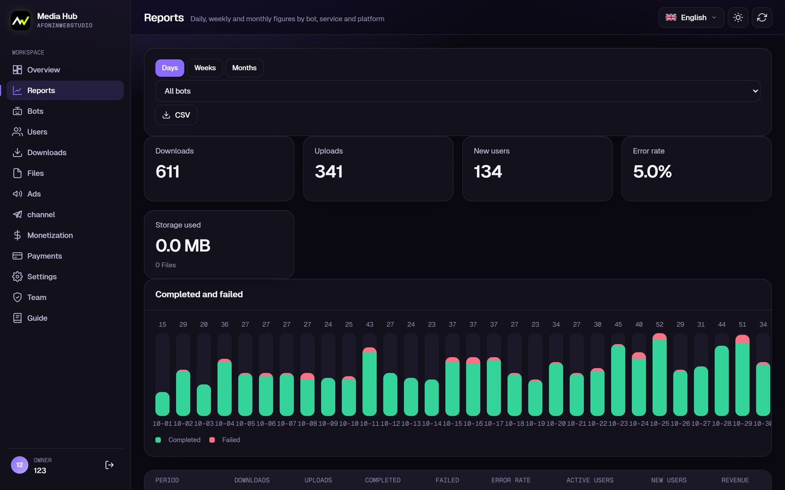
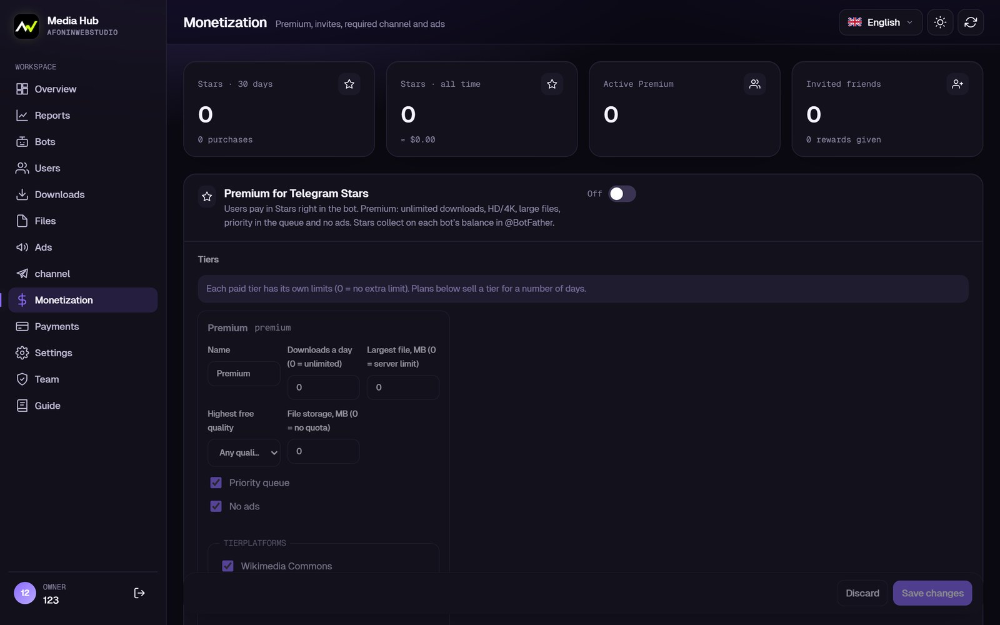
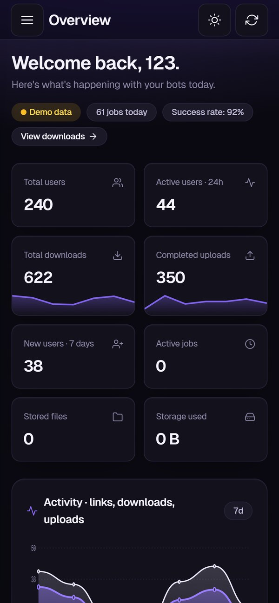
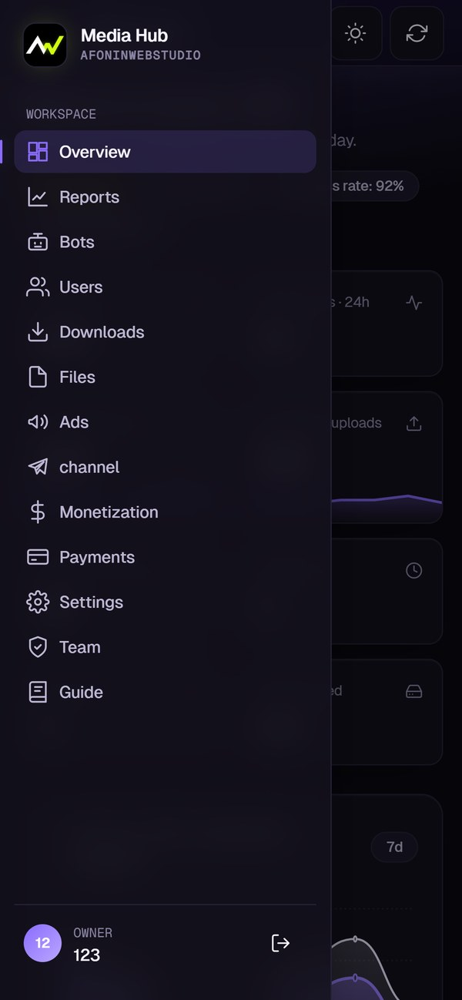
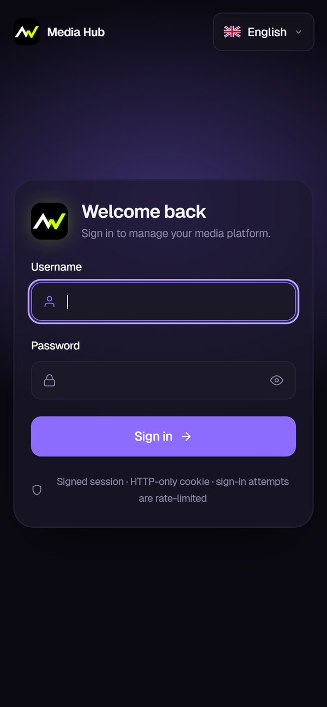
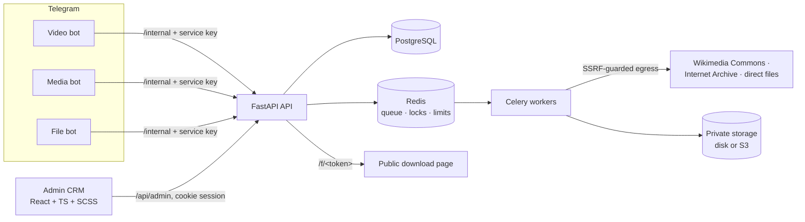

<div align="center">


# Media Hub

**One backend and one admin CRM for a whole family of Telegram bots.**

Users, jobs, files, payments, broadcasts and analytics of every bot in a single dark dashboard —
with a queue that never loses a job and a media pipeline that only touches content you may use.

`Python 3.12` · `FastAPI` · `PostgreSQL` · `Redis + Celery` · `aiogram 3` · `React 19 + TypeScript` · `SCSS` · `Docker Compose`



</div>

---

## Contents

[What it is](#what-it-is) · [Screenshots](#screenshots) · [Features](#features) · [Architecture](#architecture) ·
[Run it locally](#run-it-locally) · [Deploy](#deploy) · [Tests](#tests) · [Project structure](#project-structure) ·
[Documentation](#documentation) · [Licence](#licence)

## What it is

Media Hub runs **three Telegram bots on one shared core**:

| Bot | What it does |
|---|---|
| **Video bot** | Videos from free-licence libraries (Internet Archive, Wikimedia Commons): card with details, every available quality and the item's **licence**, delivery as a playable video + file |
| **Media bot** | Openly licensed photos, audio and video plus **direct links to media files**; collections arrive as one album |
| **File bot** | Upload a file → private storage → a public download link on your own domain, with expiry, revoke and storage quotas |

All bots share users, language, limits, Premium tiers and payments. The admin CRM controls everything without touching
the server: bot tokens and appearance, sources per bot, tiers and plans, ads, a public channel, team roles and an audit log.

Social networks and video platforms whose terms forbid downloading are **rejected by design** —
see [docs/LEGAL.md](docs/LEGAL.md).

## Screenshots

| Sign-in | Bots | Users |
|---|---|---|
|  |  |  |
| **Reports** | **Monetization** | |
|  |  | |

<p align="center">
  &nbsp;&nbsp;
  &nbsp;&nbsp;
  
</p>

<sub>Screenshots use the built-in demo mode: synthetic users <code>demo_*</code>, marked “Demo data” in the dashboard.</sub>

## Features

**Bots and media pipeline**
- Link → info card (title, author, duration, licence, real formats with sizes) → one tap → file in the chat;
  files above Telegram's 50 MB arrive as a download link.
- Only formats the extractor really reports; HD/4K and large files can be Premium-only; progress and **Cancel** button.
- Idempotent jobs: a repeated message or button press never downloads or sends twice.

**Admin CRM**
- Overview built from real data: KPI strip, activity chart, delivered vs failed, requests by source, link-to-file funnel
  and a **weekday × time heatmap** to schedule broadcasts.
- Users (ban, credits, Premium), downloads and files (preview, revoke, delete), daily/weekly/monthly reports with CSV.
- Monetization: tiers and plans, free limits, required channels, ads with weights and limits, referrals.
- Payments: **Telegram Stars, Stripe, crypto**; Premium is granted only from a verified webhook, once per transaction.
- Broadcasts and a managed public channel (schedule, edit, pin, delete).
- Team with roles and permissions, audit log, monitoring and alerts.
- **11 languages** (incl. Arabic, Hebrew, Urdu right-to-left), installable on phones (PWA), dark and light themes.

**Engineering**
- Thin bots: no business logic in bots, every action goes through the API with a per-bot service key.
- Reliable queue: jobs stored before queuing, reconciliation of lost or stuck jobs, retries for temporary errors.
- Security: SSRF guard (egress proxy pins the checked IP), Argon2 passwords, HTTP-only cookie session with Origin
  check, rate-limited sign-in, private storage served only through expiring links.
- Design system in **SCSS**: tokens → CSS custom properties, functions and mixins, WCAG AA contrast checked by a test.

## Architecture



More: [docs/ARCHITECTURE.md](docs/ARCHITECTURE.md).

## Run it locally

No Docker needed: SQLite, in-process Redis and disk storage.

```bash
python -m venv .venv && .venv\Scripts\activate          # Windows (Linux/macOS: source .venv/bin/activate)
pip install -e ".[test]" lupa
python -m infrastructure.scripts.dev                       # API on http://127.0.0.1:8000
```

```bash
cd dashboard && npm ci && npm run dev                      # dashboard on http://localhost:5173
```

The first run creates an owner account and prints where its password is saved (`local/dev-admin.txt`).
Set `DEMO_DATA=1` before the first command to fill an empty local database with clearly marked demo data.
Bot tokens for live testing go to `local/.env` (`VIDEO_BOT_TOKEN`, `MEDIA_BOT_TOKEN`, `FILES_BOT_TOKEN`).

## Deploy

Any Linux server with Docker (Plesk, nginx, Apache or Caddy in front):

```bash
cp .env.example .env && chmod 600 .env        # fill in every CHANGE_ME, the bot tokens and the domains
sudo bash infrastructure/scripts/server-setup.sh media.example.com
```

The script backs up the database before every update, applies migrations and restarts the services.
Step by step: [docs/DEPLOYMENT.md](docs/DEPLOYMENT.md) · [docs/PLESK.md](docs/PLESK.md) · [docs/BACKUPS.md](docs/BACKUPS.md).

## Tests

```bash
pytest -q                                                   # unit + integration (SQLite, fakeredis, moto)
TEST_DATABASE_URL=postgresql+psycopg://... pytest -q tests/integration
cd dashboard && npx tsc --noEmit && npx vite build
```

148 tests cover jobs and limits, payments and webhooks, monetization, broadcasts, the channel, team permissions,
translations in all 11 languages, SSRF protection, storage backends and the design tokens' contrast.
GitHub Actions runs them on every push ([.github/workflows/ci.yml](.github/workflows/ci.yml)).

## Project structure

```
backend/          FastAPI app: api/ (routers), services/ (business logic, i18n locales), models/, database/migrations/
bots/             aiogram bots: common/ runtime, video/, media/, file_sharing/
workers/          Celery tasks: media pipeline, delivery, broadcasts, channel, monitoring, cleanup
storage/          private file storage (disk or S3) and public links
dashboard/        admin CRM: React + TypeScript + Vite, styles/ (SCSS design system)
infrastructure/   Dockerfile, egress (SSRF guard), server setup, web-server snippets, local runner, demo data
tests/            unit/ and integration/
docs/             documentation
```

## Documentation

| Topic | Document |
|---|---|
| Using the dashboard | [Admin guide](docs/ADMIN_GUIDE.md) · [Monetization](docs/MONETIZATION.md) · [Payments](docs/PAYMENTS.md) |
| Running the server | [Deployment](docs/DEPLOYMENT.md) · [Plesk](docs/PLESK.md) · [Backups and updates](docs/BACKUPS.md) |
| Developing | [Architecture](docs/ARCHITECTURE.md) · [API](docs/API.md) · [Extending](docs/EXTENDING.md) |
| Scope and law | [Limitations](docs/LIMITATIONS.md) · [Legal design](docs/LEGAL.md) · [Third-party notices](THIRD_PARTY_NOTICES.md) |

## Licence

Source-available, **all rights reserved** — see [LICENSE](LICENSE). The code may be read and run locally to evaluate it;
any other use needs written permission.

Built by **Vladislav Afonin · [AfoninWebStudio](https://github.com/TheLustYoung)** — custom bots, admin dashboards and
business automation. Need a platform like this for your product? Open an issue or get in touch through the profile.
